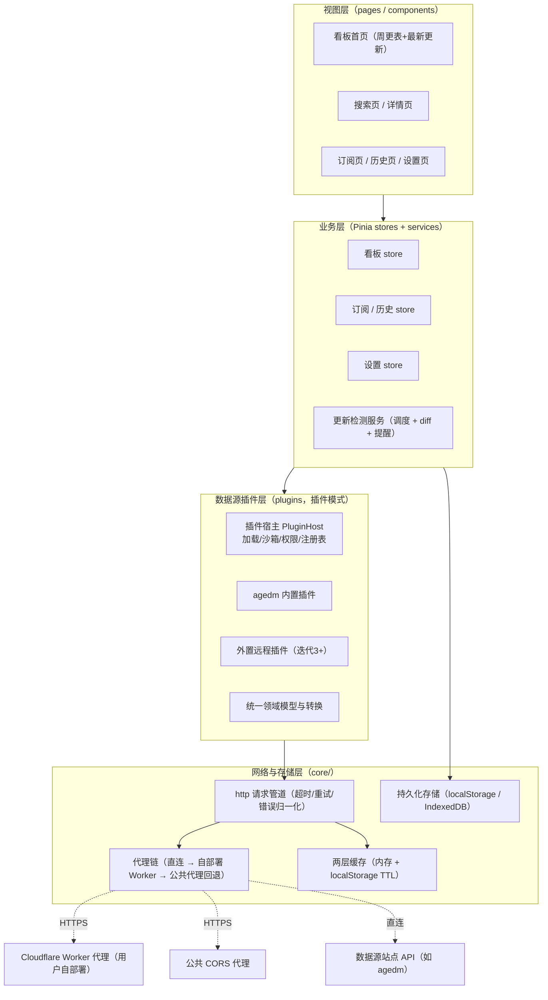
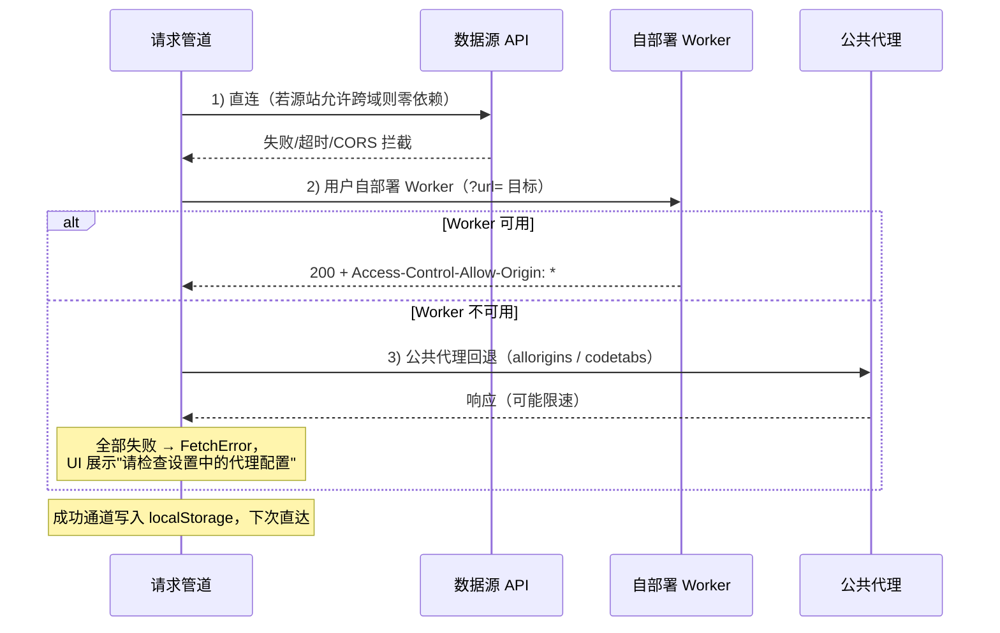
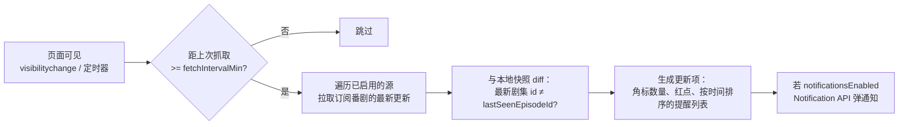

# 动漫更新看板 — 技术架构设计

| 项目 | 内容 |
| --- | --- |
| 文档版本 | v1.0 |
| 日期 | 2026-10-18 |
| 状态 | 已评审（随迭代演进，变更记录见文末） |
| 关联文档 | [功能迭代计划](./功能迭代计划.md) |

---

## 1. 项目概述

### 1.1 背景与目标

「动漫更新看板」是一个**纯前端**实现的动漫更新聚合工具：从多个动漫网站数据源拉取更新信息，为用户提供每周更新时间表、最新更新列表、追番订阅与更新提醒。项目以静态站点形式部署在 GitHub Pages，不依赖任何自建后端。

核心用户价值：

1. **一站看更新**：把分散在不同动漫网站的更新信息聚合成一张看板（周更时间表 + 最新更新流）。
2. **追番不遗漏**：订阅想追的番，有更新时在看板内以红点/角标与系统通知提醒。
3. **快速直达**：从看板一步跳转到源站播放页（后续迭代支持站内播放）。

### 1.2 范围与非目标

**范围内**：多数据源适配、看板展示、搜索、详情、订阅与更新提醒、观看记录、跳转源站播放、后期站内播放。

**非目标（明确不做）**：

- 不搭建任何后端服务、不做用户账号体系（个人数据全部存于浏览器本地）。
- 不转存、不代理视频流本身（站内播放为后期迭代，且只做播放器封装）。
- 不做弹幕、评论等社区功能。

### 1.3 首选数据源与已知不确定性

首选数据源为 [m.agedm.io](https://m.agedm.io)（Age动漫）移动站。

> ⚠️ **重要**：本项目立项调研时受网络环境限制，未能完成对 agedm 接口的实测（历史上第三方客户端使用的 `api.agedm.io:2849` 接口在调研时连接超时，域名/端口可能已变更）。因此：
>
> 1. **迭代 0 的第一个任务就是「数据源连通性探测」**，实测当前可用的接口域名、路径、参数、返回结构与 CORS 行为，产出《数据源探测报告》（`docs/探测报告-agedm.md`，由迭代 0 产出）。
> 2. **插件层的**接口地址、路径全部**配置化**，探测结果只修改插件清单配置与字段映射，不动架构。

---

## 2. 技术选型

| 维度 | 选型 | 理由 |
| --- | --- | --- |
| 框架 | Vue 3（`<script setup>` + Composition API） | 已确认选型；中文社区资料丰富，模板表达力强 |
| 构建 | Vite 7 + TypeScript | 静态产物天然适配 GitHub Pages；开发体验好 |
| 状态管理 | Pinia | Vue 官方推荐，类型推导友好 |
| 路由 | vue-router 4（**hash 模式**） | GitHub Pages 子路径部署下避免刷新 404，零服务端配置 |
| UI | Tailwind CSS（v4，`@tailwindcss/vite` 插件）+ 少量自建组件 | 移动优先、响应式；不引入重组件库控制包体 |
| 存储 | localStorage + IndexedDB（原生封装 `storage/` 模块） | 见 §5.4 分工方案 |
| HTTP | 原生 `fetch` 封装 | 无需 axios，便于注入代理链与缓存 |
| 播放（迭代 3） | hls.js | m3u8 直播/点播通用方案 |
| 测试 | Vitest（数据源插件用录制夹具回放测试） | 插件是回归风险最高的部分，必须有夹具测试 |
| CI/CD | GitHub Actions | push 即构建并发布到 GitHub Pages |

## 3. 总体架构

### 3.1 架构原则

1. **数据源插件化**：每个站点的解析是一个独立插件（内置或外置），站点差异——包括 JSON API 与 HTML 解析这类完全不同的解析方法——被隔离在各自插件内，上层只面向统一领域模型与接口规范。
2. **纯前端优先**：任何能力优先在浏览器内实现；外部依赖只有「数据源站点」与「可选 CORS 代理」。
3. **隐私本地化**：订阅、历史、偏好只存本地，不采集不上报。
4. **可降级**：网络失败、代理失效、源站改版都要有可感知的降级路径（缓存兜底、错误态、代理自动切换）。

### 3.2 架构分层图



### 3.3 目录结构规划

```
AnimeShortcut/
├─ docs/                      # 本文档、迭代计划、探测报告
├─ worker/                    # Cloudflare Worker 代理源码与部署脚本（迭代1）
├─ src/
│  ├─ pages/                  # 路由页面：Board / Search / AnimeDetail / Subscriptions / History / Settings
│  ├─ components/             # 通用组件：封面卡片、骨架屏、错误态、周更表等
│  ├─ stores/                 # pinia：board / subscription / history / settings
│  ├─ services/               # 更新检测、抓取调度
│  ├─ plugins/
│  │  ├─ host/                # 插件宿主：加载器、Worker 沙箱桥、权限校验、注册表、PluginContext 实现
│  │  └─ sources/             # 内置数据源插件（agedm/ 等），规范见《数据源插件接口规范》
│  ├─ core/
│  │  ├─ http/                # 请求管道、代理链、缓存（被插件宿主复用）
│  │  └─ storage/             # localStorage / IndexedDB 封装
│  ├─ router/                 # hash 路由表
│  └─ App.vue / main.ts
├─ .github/workflows/deploy.yml
├─ vite.config.ts
└─ package.json
```

## 4. 核心设计

### 4.1 数据源插件层（插件模式）

站点解析全部以**插件**为单位组织：每个站点（如 agedm）是一个独立插件，由「清单 manifest + 解析实现」构成，通过统一接口接入宿主。不同站点解析方法的差异（JSON API / HTML 结构解析 / 混合）被完全封装在各自插件内，宿主与业务层不感知。

架构要点：

- **两种插件形态**：`builtin` 内置插件（随应用发布，agedm 为首个）与 `remote` 外置插件（用户在设置页添加插件 URL，强制 Worker 沙箱加载，迭代 3 试点）。
- **插件宿主（PluginHost）**：负责清单校验、沙箱加载（Worker postMessage 桥）、权限校验（域名白名单）、能力协商（manifest 声明 `capabilities`，宿主只调用已声明且实现的方法）、生命周期管理（init / 服务期 / onConfigChange / onUnload）。
- **受限运行时**：插件只能通过宿主注入的 `PluginContext` 访问外部世界——受限 http（自动接入代理链、限流、超时）、轻量 DOM 解析助手、私有 KV 存储、日志与工具函数；直接访问 `window`/`fetch` 视为违规实现。
- **统一领域模型**：插件把站点原始数据映射为统一模型（AnimeSummary / AnimeDetail / Episode / PagedResult / PlayResult），`sourceId` 由宿主注入，复合主键 `${sourceId}:${animeId}` 贯穿订阅、历史、快照。
- **行为契约**：分页语义、错误码、时区（weekday 按 UTC+9 档期语义）、字段净化（纯文本 + https）、单次调用请求预算等由规范统一约定。

完整的接口签名、manifest schema、Worker 消息协议、错误码表、安装信任流程、打包分发与测试夹具规范，见 **[数据源插件接口规范](./数据源插件接口规范.md)**（normative）。

agedm 插件的实现依据仍是迭代 0 的《探测报告-agedm.md》（见 §1.3）：插件清单与字段映射按实测结果填写；实现时同步产出 `mapping.ts`、`__fixtures__/*.json` 与夹具回放测试，源站一旦改版，重录夹具即可定位差异。

### 4.2 网络层与跨域（CORS）方案

#### 4.2.1 请求管道

```ts
interface RequestOptions {
  timeoutMs?: number;      // 默认 10s
  retries?: number;        // 默认 0（通道回退已含冗余，避免全失败时的长阻塞）
  proxyPolicy?: 'auto' | 'direct-only' | 'proxy-only';
}
async function requestJson<T>(url: string, opts?: RequestOptions): Promise<T>;
```

职责：超时控制（`AbortController`）、重试、**错误归一化**（统一错误类型 `FetchError { kind: 'timeout' | 'network' | 'proxy' | 'http-status' | 'parse' }`），供上层展示明确的失败原因。

#### 4.2.2 代理链策略（已确认方案）

对数据源的每个请求按以下顺序尝试，成功后**记住本次可用通道**（localStorage），后续请求直接复用，避免每次都从直连开始重试：



- **自部署 Worker（主通道）**：`worker/` 目录提供一份 Cloudflare Worker 源码 + 「Deploy to Cloudflare」按钮文档，免费额度（10 万请求/日）完全够个人使用。Worker 内置**目标域名白名单**，只转发数据源域名，防止被滥用。
- **公共代理（回退）**：内置 2~3 个公共 CORS 代理，按顺序自动切换；公共代理有速率限制与稳定性风险，仅作兜底，UI 中明确提示「自部署代理以获得稳定体验」。
- 用户可在设置页填入自己的 Worker 地址（`https://xxx.workers.dev`），存入 settings。
- 本地开发另有零依赖通道：Vite dev server 同源代理（`vite.config.ts` 中 `/agedm-api` → `api.agedm.io`），开发时无需部署任何代理即可联调真实数据。

#### 4.2.3 Cloudflare Worker 代理参考实现（迭代 1 交付物）

```js
export default {
  async fetch(request) {
    if (request.method === 'OPTIONS') {
      return new Response(null, { headers: {
        'Access-Control-Allow-Origin': '*',
        'Access-Control-Allow-Methods': 'GET,HEAD,OPTIONS',
        'Access-Control-Max-Age': '86400',
      }});
    }
    const target = new URL(request.url).searchParams.get('url');
    if (!target) return new Response('missing url', { status: 400 });
    const host = new URL(target).hostname;
    const ALLOWED = ['agedm.io'];            // 白名单：仅转发数据源域名
    if (!ALLOWED.some(h => host === h || host.endsWith('.' + h))) {
      return new Response('host not allowed', { status: 403 });
    }
    const resp = await fetch(target, {
      headers: { 'User-Agent': request.headers.get('user-agent') ?? '' },
    });
    const headers = new Headers(resp.headers);
    headers.set('Access-Control-Allow-Origin', '*');
    return new Response(resp.body, { status: resp.status, headers });
  },
};
```

### 4.3 缓存设计

| 层 | 实现 | 作用 |
| --- | --- | --- |
| 内存层 | `Map<cacheKey, { data, expireAt }>` | 会话内去重，避免路由切换重复请求 |
| 本地层 | localStorage，JSON + TTL | 冷启动秒开（先渲染缓存再后台刷新） |

- `cacheKey = sourceId + 接口名 + 参数哈希`。
- TTL 策略：周更表/最新更新 10 分钟；详情 1 小时；搜索 0（不缓存）。
- 缓存只做**体验优化**，失败时允许返回过期数据并标注「缓存于 xx 分钟前」。

### 5. 本地持久化存储

### 5.1 分工

| 数据 | 介质 | 说明 |
| --- | --- | --- |
| 设置项（代理地址、通知开关、源启停、抓取频率） | localStorage | 量小、同步读 |
| HTTP 缓存 | localStorage | 带 TTL 与键前缀 `asc:cache:` |
| 订阅列表、观看历史 | IndexedDB | 可能增长到数百条，需要游标分页 |
| 更新快照（用于 diff） | IndexedDB | 每订阅一条 `lastSeen` 指针 |

存储统一经 `core/storage/` 模块读写，上层不直接触碰 localStorage/IndexedDB API，底层可替换。

### 5.2 schema（均带 `schemaVersion` 字段）

```ts
// 订阅（IndexedDB: subscriptions，keyPath: "sourceId:animeId"）
interface Subscription {
  key: string;             // `${sourceId}:${animeId}`
  sourceId: string;
  animeId: string;
  title: string;
  cover?: string;
  createdAt: number;
  lastSeenEpisodeId?: string;  // 已读指针，diff 的基准
  lastSeenIndex: number;       // 已读指针的剧集序号（主线路 0-based）【迭代2追加】
  notifyEnabled: boolean;
}

// 观看历史（IndexedDB: history，keyPath: key，按 watchedAt 索引）
interface HistoryEntry {
  key: string;             // `${sourceId}:${animeId}:${episodeId}`
  sourceId: string; animeId: string; episodeId: string;
  title: string; episodeTitle: string;
  watchedAt: number;       // 用于排序与"继续观看"
}

// 设置（localStorage: asc:settings）
interface Settings {
  schemaVersion: number;
  proxyWorkerUrl?: string;
  fetchIntervalMin: number;      // 默认 30
  notificationsEnabled: boolean;
  enabledSources: string[];
}
```

### 5.3 版本迁移

`storage/` 模块启动时读取 `schemaVersion`，小于当前版本则依序执行迁移函数（如 localStorage → IndexedDB 的一次性搬迁，用于迭代 1 数据结构升级到迭代 2 结构）。

## 6. 更新检测与提醒



要点：

- **仅前台提醒**：GitHub Pages 无后端，浏览器关闭时无法推送。页面打开时按可见性调度抓取（切后台暂停，回到前台立即检查一次），这是纯前端方案的固有限制，已在产品层接受。
- **diff 基准**是每个订阅的 `lastSeenEpisodeId`，用户点进详情/播放后更新指针，红点消失。
- 提醒信息聚合为「今天有 N 部更新」，避免逐条打扰。
- 抓取失败静默降级（沿用上次快照），连续失败 3 次后在设置页提示检查代理。

## 7. 路由与页面结构

hash 路由表（`createWebHashHistory`）：

| 路由 | 页面 | 出现迭代 |
| --- | --- | --- |
| `#/` | 看板首页：周更时间表（周一~周日分组）+ 最新更新流 | 迭代 1 |
| `#/search` | 搜索与结果列表 | 迭代 1 |
| `#/anime/:sourceId/:animeId` | 详情：封面、简介、剧集列表、更新状态 | 迭代 1 |
| `#/subscriptions` | 我的追番（订阅管理、更新红点） | 迭代 2 |
| `#/history` | 观看历史与继续观看 | 迭代 2 |
| `#/settings` | 数据源管理、代理配置、提醒与备份 | 迭代 1 基础 / 迭代 3 完善 |

布局：顶部 Tab 导航 + 内容区（移动优先，桌面端限宽居中）；全局骨架屏与错误态组件。

## 8. 部署方案（GitHub Pages）

- **构建产物**：`vite build` 产出静态文件；`vite.config.ts` 中 `base: '/AnimeShortcut/'`（以仓库名为准，用户名 Pages 仓库则用 `/`）。
- **发布方式**：GitHub Actions 官方 Pages 流程（build → upload-pages-artifact → deploy-pages），推送 `main` 即自动发布。

```yaml
# .github/workflows/deploy.yml（迭代 0 交付物）
name: Deploy
on:
  push: { branches: [main] }
  workflow_dispatch:
permissions: { pages: write, id-token: write, contents: read }
concurrency: { group: pages, cancel-in-progress: true }
jobs:
  build:
    runs-on: ubuntu-latest
    steps:
      - uses: actions/checkout@v4
      - uses: actions/setup-node@v4
        with: { node-version: 22, cache: npm }
      - run: npm ci && npm run build
      - uses: actions/upload-pages-artifact@v3
        with: { path: dist }
  deploy:
    needs: build
    runs-on: ubuntu-latest
    environment: { name: github-pages, url: ${{ steps.d.outputs.page_url }} }
    steps:
      - id: d
        uses: actions/deploy-pages@v4
```

- 首次启用：仓库 Settings → Pages → Source 选 **GitHub Actions**。
- 静态资源带内容哈希，长期缓存无问题；`index.html` 由 Pages 默认策略缓存。

## 9. 性能与体验考量

- **封面懒加载**（`loading="lazy"`）+ 可选图片代理（源站图片若带防盗链，经 Worker 转发并改写 Referer）。
- 列表分页 + 上拉加载；订阅/历史超 200 条时列表虚拟滚动（迭代 2+）。
- 冷启动先用 localStorage 缓存渲染，后台刷新数据（stale-while-revalidate 语义）。
- 包体控制：不引入大型组件库；hls.js 在迭代 3 采用动态 `import()` 按需加载。

## 10. 安全与合规

- 应用仅做**信息聚合与官方入口跳转**，不存储、不分发任何视频文件；详情页与播放按钮明确标注来源站点与跳转行为。
- 不采集、不上传任何用户数据；订阅与历史仅存本地，导出备份由用户手动触发。
- Worker 代理带域名白名单，防止被第三方滥用流量。
- 对源站遵守robots 与访问频率礼貌原则（缓存 + 抓取间隔限制）。
- XSS 防护：源站返回的文本一律经 Vue 模板转义渲染，禁用 `v-html` 渲染源站内容；封面 URL 白名单校验协议（仅 https）。

## 11. 风险与对策

| # | 风险 | 可能性 | 影响 | 对策 |
| --- | --- | --- | --- | --- |
| 1 | agedm 当前接口形态未知/与历史线索不符 | 高 | 迭代 1 阻塞 | 迭代 0 优先探测；插件接口配置化；准备「页面解析」备选方案（解析周更表 HTML） |
| 2 | 源站 CORS 不开放且公共代理全被限 | 中 | 数据拉不到 | 自部署 Worker 为主通道；文档提供 5 分钟部署指引 |
| 3 | 源站改版/换域名 | 高 | 插件失效 | 域名与路径全配置化；夹具测试快速定位；看板多源设计保证单源失效不影响整体 |
| 4 | 站内播放遇到防盗链/Referer 校验（迭代 3） | 中高 | 无法播流 | Worker 转发流媒体需评估流量成本；优先保「跳转源站播放」路径 |
| 5 | 公共代理/源站对 IP 限速 | 中 | 偶发失败 | 抓取间隔 + 缓存 TTL + 指数退避；UI 明示失败原因 |
| 6 | 内容合规风险 | 低 | 项目性质 | 保持聚合+跳转定位，不转存内容，README 声明 |
| 7 | 外置远程插件引入第三方代码的安全风险 | 中（启用该功能时） | 页面数据被窃取/滥用 | 迭代 3 才开放且默认关闭；Worker 沙箱隔离、安装权限确认、宿主侧域名白名单与存储命名空间隔离 |

## 12. 未来演进（迭代 4 及以后）

PWA 离线壳与桌面安装、深色模式、数据导入导出（JSON 备份/恢复）、封面代理与图片优化、更多数据源（樱花动漫等，走同一插件规范）、可选的「自建定时抓取服务」作为演进分支（打破纯前台的提醒限制，属可选部署）。

## 变更记录

| 日期 | 版本 | 变更 |
| --- | --- | --- |
| 2026-10-18 | v1.0 | 初稿，随迭代 0 探测结果修订 §4.1.3 与 §11.1 |
| 2026-10-18 | v1.1 | 数据源层改为**插件模式**（§4.1 重写），新增 normative《数据源插件接口规范》，风险表补充外置插件安全项 |
