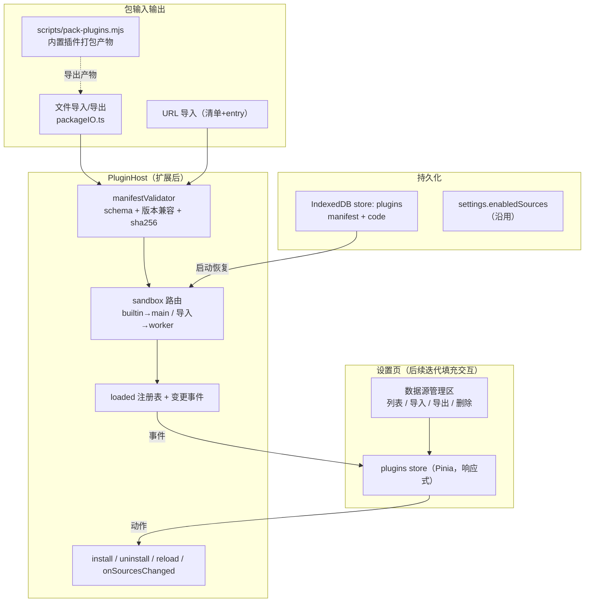

# 动漫更新看板 — 插件导入导出与热插拔设计

| 项目 | 内容 |
| --- | --- |
| 文档版本 | v1.0 |
| 日期 | 2026-10-18 |
| 状态 | 已实施（2026-10-18，A~C 阶段与设置页 UI 已交付；变更走变更记录） |
| 关联文档 | [数据源插件接口规范](./数据源插件接口规范.md)（normative）、[技术架构设计](./技术架构设计.md)、[功能迭代计划](./功能迭代计划.md) |

---

## 1. 背景与结论

### 1.1 分析结论

数据源解析逻辑**已经完成插件化封装**（迭代 1 交付）：`src/plugins/host/`（PluginHost + PluginContext + 类型契约）与 `src/plugins/sources/agedm/`（首个内置插件）按《数据源插件接口规范》实现，业务层只面向 `sources.*` 统一能力调用，站点解析差异已被隔离在插件内。**本设计不再重做封装，只补齐运行时动态能力。**

对照「导入导出 + 热插拔」目标，当前宿主存在四类缺口：

| # | 缺口 | 现状证据 |
| --- | --- | --- |
| G1 | **只能静态加载**：插件注册表是编译期常量，宿主仅启动时初始化一次 | `src/plugins/sources/registry.ts` 静态数组；`host.ts` 注释「remote 插件在迭代 3 引入」 |
| G2 | **无热插拔 API**：`loaded` Map 模块私有，无 install/uninstall/reload，无 `onUnload` 调用与缓存清理，无变更事件 | `host.ts` 全量可导出 API 仅 `initPluginHost / listSources / sources` |
| G3 | **无导入导出**：没有插件包文件格式、没有 sha256 校验与权限确认的实现、内置插件也没有可分发产物 | 规范 §11/§12 仅定义了流程与格式方向，未落地 |
| G4 | **无持久化**：已安装插件无处保存（重启即丢）；`listSources()` 返回普通数组，设置页一次性取值，UI 不响应插件集变化 | `SettingsPage.vue` `const sources = listSources()`；idb 仅有 `subscriptions`/`history` 两个 store |

### 1.2 目标

1. **导入**：从插件包文件（或插件清单 URL）安装数据源插件，含校验、sha256、权限确认、探活的完整信任流程（规范 §11）。
2. **导出**：已安装插件可导出为可再导入的包文件；内置插件（agedm）随构建产出可分发包。
3. **热插拔**：不停机安装/卸载/更新/重载插件；卸载触发 `onUnload` 与缓存/私有存储清理；注册表变化以事件驱动 UI 刷新。
4. **为 UI 做准备**：定义设置页「数据源管理」的接入点（响应式 store、导入/导出/删除交互契约），本期交付宿主内核与 store，页面交互随后续迭代填充。

### 1.3 非目标

- 不改动统一领域模型与能力方法签名（规范 §5/§7/§15 不动）。
- 不做插件市场/在线列表、签名链与自动更新（包级 sha256 已覆盖完整性；「更新」= 同 id 重新导入）。
- 不做插件级限流面板与请求统计（迭代 3-1 的既有范围）。

## 2. 总体设计



关键决策（均为对规范的落地或收敛，不引入规范变更）：

| 决策 | 内容 | 依据 |
| --- | --- | --- |
| D1 沙箱 | 导入插件**强制 Worker 沙箱**；`main` 沙箱保留给内置插件；`import.meta.env.DEV` 下允许导入插件临时跑 main 便于调试 | 规范 §3「remote 强制 worker」；§6.1 开发联调例外的同款精神 |
| D2 包格式 | 单文件 JSON 包（`formatVersion: 1`）= `manifest + code(文本)`，扩展名 `.asplugin` | 免 zip 依赖；可直接 FileReader/IndexedDB/下载；code 为 IIFE 自包含 bundle，无跨域 import |
| D3 内置插件导出 | 构建期脚本把 `src/plugins/sources/<id>` 用 esbuild 打成同样的 `.asplugin` 产物，随 Pages 部署，导出按钮直接取产物 | 内置插件源码是 TS，运行时无法自行打包 |
| D4 变更通知 | 宿主内聚注册表与事件，UI 通过新增 `stores/plugins.ts`（订阅事件）获得响应式列表；页面以 watch 触发重拉 | 现有 `configRev` 模式的推广 |
| D5 卸载语义 | 卸载只摘除插件与缓存，**不删**订阅/历史（key 含 sourceId，重装同 id 即恢复语义）；私有 KV 默认保留、用户可选清除 | 复合主键设计（规范 §7.2） |
| D6 功能开关 | 设置新增 `enableRemotePlugins`（默认 false），只控制导入入口显隐；已安装插件照常装载 | 规范 §11「默认不开启外置插件入口」 |

## 3. 插件包格式（导入/导出的载体）

```jsonc
// <id>.asplugin —— 单文件，UTF-8 JSON
{
  "formatVersion": 1,
  "manifest": {
    // 完整 PluginManifest（规范 §4），且导入包内必须满足：
    //   type: "remote"、sandbox: "worker"、entry: "index.js"、sha256: "<code 的 hex 摘要>"
    "manifestVersion": "1.0",
    "id": "example",
    "name": "示例站",
    "version": "1.0.0",
    "siteUrl": "https://example.com",
    "type": "remote",
    "entry": "index.js",
    "sandbox": "worker",
    "capabilities": ["search", "detail"],
    "permissions": { "domains": ["example.com"] },
    "sha256": "…"
  },
  "code": "(function(){ … })();  /* esbuild --bundle --format=iife 产物，末尾 self.__AS_PLUGIN__ = factory */"
}
```

- `code` 必须是**自包含 IIFE**（不允许残留 `import`/`export` 语句），工厂函数按规范 §5.1 挂 `self.__AS_PLUGIN__`。
- 导入时宿主重算 sha256 与 `manifest.sha256` 比对；清单缺省 sha256 时补算回填（持久化后每次启动装载都校验）。
- URL 导入（规范 §11 第 1 步的「粘贴清单 URL」）：宿主 fetch `<url>/plugin.json`（或用户给的清单直链）→ 由 `entry` 字段 fetch `index.js` → 在内存组装成同一包格式，后续管线与文件导入完全一致。要求托管源允许跨域（规范 §12 建议 GitHub Raw / jsDelivr）。
- 内置插件产物（D3）：`npm run pack:plugins`（用 Vite 已随附的 rolldown，未新增依赖）按 `src/plugins/sources/*/manifest.ts` 逐个产出 `public/plugins/<id>.asplugin.json`——public 产物 dev server 即时可访问，`vite build` 自动拷贝进 `dist/` 随 Pages 部署；`npm run build` 已串联该脚本，导出按钮 fetch `import.meta.env.BASE_URL + 'plugins/<id>.asplugin.json'`。

## 4. 热插拔内核（host.ts 扩展）

### 4.1 新增 API

```ts
/** 导入/导出共用的包结构（src/plugins/host/types.ts 追加） */
export interface PluginPackage {
  formatVersion: 1
  manifest: PluginManifest
  code: string
}

export interface InstallResult {
  info: SourceInfo
  /** 首次安装返回权限摘要，供 UI 复核展示 */
  manifest: PluginManifest
}

/** 安装（同 id 已存在时 = 更新：先卸载旧实例再装载新包） */
export async function installPlugin(
  pkg: PluginPackage,
  opts?: { persist?: boolean },        // 默认 true（内置/测试注入可关）
): Promise<InstallResult>

/** 卸载：onUnload → 终止沙箱 → 摘除注册表 → 清方法级缓存 →（可选）清私有 KV → 删持久化 */
export async function uninstallPlugin(id: string, opts?: { wipeStorage?: boolean }): Promise<void>

/** 重载：用于运行中插件换配置/换版本后的确定性重建（= unload + 按 origin 装载） */
export async function reloadPlugin(id: string): Promise<void>

/** 注册表变更订阅；返回取消函数。UI store 唯一消费方 */
export function onSourcesChanged(cb: (sources: SourceInfo[]) => void): () => void
```

### 4.2 装载路径归一

现有 `initPluginHost` 的「建 ctx → 工厂实例化 → init → 注册」与 remote 路径「建沙箱 → init → 注册」收敛为共用 `mount(manifest, instance)`，两条来源：

| 来源 | 实例化方式 | 沙箱 |
| --- | --- | --- |
| 内置工厂（现有 registry） | `factory(ctx)` 直调 | `main`（ctx 含 domDocument） |
| 已安装包（IDB 恢复 / 运行时安装） | Worker 沙箱桥（§5），工厂在 worker 内取 `self.__AS_PLUGIN__` | `worker`（强制；DEV 例外见 D1） |

`initPluginHost` 启动序列扩展为：内置工厂 → `idbAll('plugins')` 逐条恢复（单条失败仅告警跳过，不阻塞启动）→ 发首次变更事件。`enabledProvider/configProvider` 机制沿用。

### 4.3 生命周期与清理

| 时机 | 动作 |
| --- | --- |
| 卸载/更新前 | 调 `onUnload()`（3s 超时后强制终止）；`sandbox.destroy()`（worker.terminate + revoke blob URL） |
| 卸载 | `loaded.delete(id)`；清方法级缓存：新增 `cacheClearByPrefix('plugin:<id>:')`（cache.ts，内存 + `asc:cache:` 本地键）；`wipeStorage` 时连 `asc:plugin:<id>:` 私有 KV 一起清 |
| 更新（同 id install） | 先走卸载，再装载新包；版本只做展示，不做降级阻止 |
| 在途调用 | 已持插件引用的 Promise 允许自然完成/失败；此后该 id 调用按现有逻辑抛 `UNSUPPORTED` |
| 安装成功 | `enabledSources` 默认加入（用户显式安装即视为启用）；发变更事件；探活失败则回滚（§6 步骤 5） |

### 4.4 事件驱动刷新

- 宿主 `onSourcesChanged` 只在注册表增删时发（启停仍走 `settings.setSourceEnabled → configRev`，职责不重复）。
- 新增 `src/stores/plugins.ts`：`sources: ref<SourceInfo[]>` 订阅事件；动作方法 `install/uninstall/toggle` 组合 host 与 settings store。
- 现有页面改造点（均是把「一次性取列表」改为响应式）：`SettingsPage` 列表改用 store；`board.ts`/`SearchPage`/`CatalogPage`/`RankPage` 在 watch `store.sources` 变化后重拉本页数据（`updateChecker` 每次调用时现取列表，无需改动）。

## 5. Worker 沙箱桥（规范 §10 的最小落地实现）

新增 `src/plugins/host/workerBridge.ts` + `workerRuntime.ts`（运行时垫片以字符串模板内置，无需独立构建产物）：

```
宿主                                      Blob Worker（runtime 垫片 + 插件 code）
 │ {v:1,id,op:"init",manifest,config} ──→ 取 self.__AS_PLUGIN__ → factory(stubCtx) → init → ok
 │ {v:1,id,op:"invoke",method,args}  ──→ 调能力方法 ──→ {v:1,id,ok,data|error}
 │ ←── {v:1,ctxId,op:"http.getJson",args}  反向 RPC：宿主用真实 PluginContext 执行后回包
 │     （http.* / dom.query / storage.* / log.* / utils.*）
```

- 宿主侧 `SandboxHandle { call(method, args): Promise; destroy(): void }`：msgId 计数、消息级 30s 超时、失败终止。
- 域名白名单在**宿主侧反向 RPC 执行点**强制（复用 `createPluginContext`，天然生效），worker 内的 stubCtx 不做校验。
- `domDocument` 在 worker 下为 undefined（对齐规范 §6）；HTML 解析走 `dom.query` 反向到主线程 DOMParser。
- 安全边界如实声明：Worker 沙箱隔离的是宿主 DOM 与用户数据（订阅/历史/settings），不是网络——插件仍可在 worker 全局直接 fetch，域名白名单只约束经 ctx 的请求；剩余风险靠 §6 的显式安装确认兜底（规范 §11 同款立场）。

## 6. 安装信任流程（规范 §11 的实现序列）

1. **解析**：文件/URL → `PluginPackage`；`formatVersion` 必须为 1。
2. **校验**（新增 `manifestValidator.ts`）：manifest schema（字段类型、`id` 正则、capabilities 子集、domains 非空、https siteUrl/entry）；`manifestVersion` 与宿主同主版本且次版本可兼容；`sandbox` 强制 `worker`（清单写 `main` 拒绝导入，DEV 例外除外）；sha256 比对。
3. **确认**：校验产物是结构化「权限摘要」（名称/版本/能力/域名列表/是否用存储/作者），UI 展示并等待用户显式确认后才调用 `installPlugin`。
4. **装载**：沙箱启动 → `init(config)` → 探活（取第一个可用无参能力调用一次，如 weekly/latest/catalog page1、rank；search 以空串、detail/play 无良性参数则跳过探活仅 init）。
5. **登记**：探活通过 → 写 IDB → 进注册表 → 发事件；任一步失败 → 销毁沙箱、不落盘，错误以 `PluginError` 语义返回 UI。
6. **卸载**：UI 提供删除入口；`wipeStorage` 复选项文案「同时清除该插件保存的数据」。

## 7. 持久化与启动恢复

- `core/storage/idb.ts`：`DB_VERSION` 1→2，`STORES` 追加 `'plugins'`（`onupgradeneeded` 增量建 store，老数据不动；内存回退自动生效）。
- 记录结构：`{ key: manifest.id, manifest, code, installedAt, origin: 'file' | 'url', sourceUrl? }`。
- 启动恢复时逐条验 sha256，不符则丢弃该条并告警（防篡改的持久层防线）。
- `settings` schema 追加 `enableRemotePlugins: boolean`（默认 false，migrate 补默认值）。

## 8. 改造清单与实施顺序

| 阶段 | 内容 | 涉及文件 |
| --- | --- | --- |
| A 热插拔内核 | §4 API、装载归一、事件、缓存清理；DEV 例外下先允许 main 沙箱装包打通全流程 | `host/types.ts`、`host/host.ts`、`http/cache.ts`、`stores/plugins.ts` |
| B 沙箱与信任 | Worker 桥、manifestValidator、sha256、探活、IDB 持久化与启动恢复 | `host/workerBridge.ts`、`host/workerRuntime.ts`、`host/manifestValidator.ts`、`host/packageIO.ts`、`core/storage/idb.ts`、`stores/settings.ts` |
| C 导入导出与产物 | 包格式落盘、文件/URL 导入、导出下载、内置插件打包脚本 | `packageIO.ts`、`scripts/pack-plugins.mjs`、`package.json`（script + esbuild devDep） |
| D UI 接入（后续迭代） | 设置页「数据源管理」：响应式列表、导入（文件/URL + 权限确认对话框）、导出、删除、重载 | `pages/SettingsPage.vue` 及看板/搜索/分类/榜单页 watch 刷新 |

测试（Vitest，沿用 host.spec 风格）：

- `manifestValidator.spec`：合法清单、版本不兼容、sandbox=main 拒绝、域名缺失、sha256 不符。
- `host.spec` 扩展：install → listSources 出现 → uninstall 消失且缓存键被清；同 id 更新走卸载重建；探活失败回滚；事件回调触发。
- `packageIO.spec`：包 round-trip（导出结构 → 再导入成功）、URL 导入的 fetch 桩。
- `workerBridge.spec`：以消息桩模拟 worker，覆盖 init/invoke/超时/反向 RPC。

## 9. 风险与对策

| # | 风险 | 对策 |
| --- | --- | --- |
| 1 | 第三方插件代码风险（Worker 内可直接 fetch，沙箱不隔离网络） | 安装显式确认 + 域名摘要展示；入口默认关闭（D6）；宿主数据与插件物理隔离（IDB/localStorage 命名空间） |
| 2 | Blob Worker 在个别环境受限（CSP/老浏览器） | 装载失败以明确错误上抛；DEV 例外可用于排查；GitHub Pages 无自定义 CSP，主路径不受影响 |
| 3 | URL 导入依赖托管源 CORS | 文档固定建议 GitHub Raw / jsDelivr（规范 §12 已有约定）；失败信息区分 CORS 与 404 |
| 4 | 卸载后既有订阅/历史「悬空」 | D5：保留数据，调用侧已有错误态兜底；重装同 id 即恢复 |
| 5 | 内置插件导出产物与源码漂移 | 产物走 CI 构建而非手维护；`pack:plugins` 挂进 deploy 流程 |

## 10. 变更记录

| 日期 | 版本 | 变更 |
| --- | --- | --- |
| 2026-10-18 | v1.0 | 初稿：现状分析（G1~G4）、包格式与导入导出、热插拔内核 API、Worker 沙箱桥、信任流程、持久化、分阶段改造清单 |
| 2026-10-18 | v1.1 | 已实施（A~C 阶段与设置页 UI 交付）；修复内置插件导出：打包产物由 dist/plugins 改写 public/plugins（dev 即时可达、构建自动拷贝），`npm run build` 串联 pack:plugins，产物缺失时导出按钮给可读指引 |
| 2026-10-19 | v1.2 | URL 导入补齐**整包直取**：URL 指向 `.asplugin.json`（含 formatVersion）时整包直接采用（规范 §12 发布物即单文件包），不再强制按「清单 + entry」二次拉取；yinhuadm 插件以该路径实测 Worker 沙箱装载成功 |
